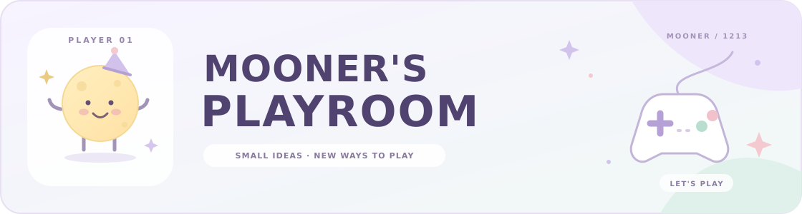

### 작은 아이디어가 플레이가 되는 곳 ✨

안녕하세요. 재미있는 순간을 기획하고 만들어 보는 **문재혁**입니다.  
아이디어를 규칙으로 정리하고 직접 플레이하며 다듬고 있어요.

## 🎮 만드는 것들

| 프로젝트 | 어떤 경험인가요? | 지금은 |
| --- | --- | --- |
| [⏸️ 일시정지!](projects/gamepaused.md) | 시간을 멈추고 다음 점프를 설계하는 등반 게임 | 프로토타입 제작 |
| [🐾 MyLittlePet](projects/mylittlepet.md) | 쓰다듬고 공놀이하며 함께 지내는 가상 강아지 | 핵심 기능 구현·시험 |
| [🔦 잔해 속의 숨](projects/breath-in-the-rubble.md) | 매몰된 공간에서 주변 도구를 활용하는 VR 경험 | 상호작용 제작 |
| [🀄 업그레이드 마작](projects/upgrade-mahjong.md) | 마작에 세 가지 중 하나의 증강을 더하는 아이디어 | 기본 대국 보완 |

프로젝트 이름을 누르면 제작 내용과 참여 범위를 볼 수 있어요.

## 🧩 작업하는 방식

- **생각을 정리해요.** 아이디어를 규칙과 플레이 흐름으로 구체화해요.
- **직접 움직여 봐요.** Unity 프로토타입에서 확인하고 수정해요.
- **AI와 함께 다듬어요.** 초안과 수정에 활용하고 결과를 확인해요.

## 🛠️ 함께 쓰는 도구

<kbd>Unity</kbd> <kbd>C#</kbd> <kbd>Git · GitHub</kbd> <kbd>VR · XR</kbd> <kbd>AI 협업</kbd>

VR/XR에서 사용하는 구성

OpenXR · XR Interaction Toolkit · PC Editor 시험 환경을 사용해요.  
프로젝트마다 대상 기기와 실제 시험 범위를 구분해서 정리하고 있어요.

---

🌙 생각하고 만들고 다시 플레이하기.

